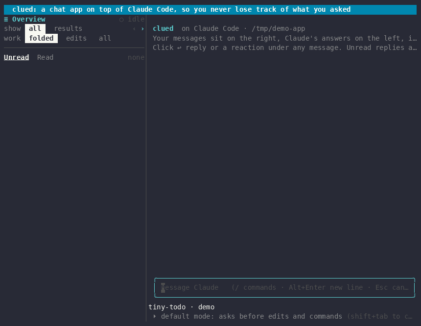

<h1 align="center">
  <picture>
    <source media="(prefers-color-scheme: dark)" srcset="docs/branding/logo-dark.png">
    <source media="(prefers-color-scheme: light)" srcset="docs/branding/logo-light.png">
    
  </picture>
</h1>

**Never lose track of what you asked Claude.**

clued is a terminal chat app for heavy Claude Code users: the ones juggling several requests, long tasks and background agents in one session. Send new requests while Claude works, and see for each one whether it's answered, in progress or waiting on you, and which reply answers it.

Underneath it's the same Claude Code, run headless: the same account, tools, permissions, plugins and sessions. clued draws the screen and keeps track of the conversation.

[](https://github.com/haytham-breaka/clued/actions/workflows/test.yml)
[](LICENSE)
[](#quick-start)

<p align="center"></p>

<p align="center"><b><a href="docs/demo.mp4">▶ Watch the 82-second narrated walkthrough</a></b></p>

## Why clued

- **Every reply says what it answers.** A reply quotes the message it answers, and one that answers three messages splits into three bubbles. From any message, `⛓ chain` opens its follow-ups, corrections and replies.
- **Every request is tracked.** Each message has a mark in the panel: ⏳ Claude is on it, ✋ waiting on you, ✓ done. Replies sometimes go missing: when Claude marks a message done but never wrote its reply, clued asks Claude again at once, and a reply still missing after that is marked `⚠ reply lost`, with `↻ ask again`, instead of looking answered.
- **Keep typing while Claude works.** A message sent while Claude is busy waits `⏳ in queue` and goes as its own turn when Claude's turn ends, so it gets its own answer. To steer the work in progress, reply to it, and your message goes in at once.
- **See the work, not just the chat.** The panel lists each agent Claude started, with a live view of its steps (background agents too), the shell commands running in the background with their output, and the jobs Claude scheduled, with when each runs next.
- **Stay in control.** Unread replies, ★ saved messages, Claude's open questions in one list, 3 seconds to edit or take back a message after Enter, and a notification when Claude asks you something while you're in another window.

## Quick start

You need [Claude Code](https://claude.com/claude-code), installed and logged in (`claude` on your PATH), **Node 22.18 or later**, git and bash (macOS's own bash 3.2 will do). It runs on Linux and macOS, both tested in CI, and on Windows through WSL.

```bash
git clone https://github.com/haytham-breaka/clued.git ~/src/clued
mkdir -p ~/.local/bin
ln -s ~/src/clued/bin/clued ~/.local/bin/clued
```

If `command -v clued` then prints nothing, `~/.local/bin` isn't on your PATH: add `export PATH="$HOME/.local/bin:$PATH"` to your `~/.zshrc` or `~/.bashrc`, and open a new terminal. There is nothing to `npm install` and no build step. To update, run `git -C ~/src/clued pull`, then `/reload` in a running clued.

```bash
cd ~/code/my-project
clued                  # new session in this folder
clued -c               # continue this folder's last session
clued --resume         # pick a session
clued --model opus     # any other flag goes to claude
```

### Try it in 30 seconds

1. Ask for something that keeps Claude busy for a while: "Read this project and tell me how it's laid out."
2. While it works, send two more: "Which parts have no tests?" and "Is anything here obviously slow?". Under **Your recent messages** in the panel, both show `in queue`.
3. Watch each one go when the turn before it ends, get its own reply quoting it, and turn to ✓. Press Ctrl+N for the next unread reply, or Alt+↑ to pick one of your messages and Alt+→ to go to its answer.

## Documentation

- [Using clued](docs/usage.md): the screen, the panel, sending while Claude works, replies, chains, agents, images, permissions, questions and notifications.
- [Keys](docs/keys.md) and selecting text.
- [Commands](docs/commands.md): how to start it, and every slash command.
- [How it works](docs/architecture.md): what clued adds to the conversation, and what it keeps on disk.
- [The evaluation](eval/RESULTS.md), and the older [classic layout](docs/classic.md).

## How it works

clued starts `claude -p` with stream-json input and output, and talks to it over stdin and stdout. Three small additions make the tracking work:

- a short guide, appended to Claude Code's system prompt, asks Claude to end each reply with one hidden tag line: which of your messages it's about, and whether each is on Claude, on you, or done;
- each message you send carries a hidden note with its id (`T12`) and the messages still open;
- a reply that answers several messages marks each part (`<<reply T12>>`), and clued draws one bubble per part.

The chat comes from Claude Code's own session file, so `-c` and `--resume` work as they do in `claude`. More in [docs/architecture.md](docs/architecture.md).

## Does it help?

clued and plain Claude Code were given the same 13 scripted conversations: messages sent mid-task, corrections, numbered questions, and references like "the second thing I asked". Sonnet, 5 runs each, 130 runs in all, with a blind judge ([the bigger run](eval/RESULTS.md#the-bigger-run-2026-11-25)). The recordings were then replayed through clued's screen and plain Claude Code's, and a small model (Haiku), told not to scroll, read one screen at a time ([Closing the gap](eval/RESULTS.md#closing-the-gap-2026-11-25-later); the numbers are after its fixes).

| | clued | plain Claude Code |
|---|---|---|
| From one screen: whether each message was answered | 99.8% (993 of 995) | 86% (856 of 995) |
| From one screen: the answer found | 91% | 83% |
| A burst of 8 messages before the first reply (5 runs): answered or not / answer found | 99% / 98% | 86% / 98% |
| Messages sent mid-task that were answered (the 8 hard scenarios) | 56 of 56 | 56 of 58 |
| Judge: answers correct / answers given to the wrong message | 100% / none | 100% / none |
| Cost per session (the 8 hard scenarios, 40 runs each) | $0.080 | $0.073 |

- **What clued adds:** you can see, for each message, whether it was answered and where. The one-screen "answer found" lead is significant at the end of the conversations (p = 0.02), not over every moment (p = 0.17).
- **What it doesn't add:** Claude's answers aren't better. The judge found every answer correct in both, and the project checks passed 100% of the time with clued and 99% without.
- **Where it's worse:** reading the whole chat, the answer was found less often with clued (94% against 98%), and clued showed more finished messages as waiting on you (23 of 659 against 2 of 694).
- **What it costs:** 9–10% more per session, for about 1,100 tokens of guide and note on the first call and a short tag on each reply. Asking again for a missing reply is an extra turn: in the burst runs, $0.090 a session against $0.071.
- **Limits:** the readers are a model, not people; plain Claude Code's screen was drawn by the eval script; the sessions are short (up to 12 messages), on Sonnet only; and the panel's fixes were tuned on the same runs they were scored on.

The method, every table and the earlier results are in [eval/RESULTS.md](eval/RESULTS.md), and the runner is in [eval/](eval/). In the eval files, clued appears under its earlier name, threadline.

## FAQ

**Do I need a separate account or an API key?** No. clued starts the `claude` you already have, logged in as you, and its use counts against your Claude Code plan or billing as usual. clued makes no API calls of its own.

**Can I go back to plain Claude Code?** Yes. Sessions are Claude Code's own: `claude --resume` or `claude -c` in the same folder opens them. There you'll see clued's notes on your messages and the tag line at the end of Claude's replies as plain text. To uninstall, delete the link in `~/.local/bin`, the clone and `~/.clued`.

**Are the threads separate sessions?** No. Everything goes into one shared Claude Code session, and Claude sees the whole conversation. clued only tracks which reply answers which message. The exception is `/btw`: a side question runs in a fork of the session and stays out of it.

**Does clued change the prompts?** Yes. It appends a guide to Claude Code's system prompt, adds a hidden note to each message you send, and asks Claude for a tag line at the end of each reply. That's the overhead measured above. Your `CLAUDE.md`, settings, permissions, plugins and hooks apply as usual.

**Can it guarantee that every request gets answered?** No. The tracking depends on Claude following the guide, and Claude sometimes doesn't. What clued does is make a missing reply visible: it asks Claude again at once, and marks a reply still missing `⚠ reply lost`, so a message never just looks answered.

**Where is my data?** The conversation stays in Claude Code's session files, as it always does. clued keeps its own files in `~/.clued/`: per session, the links between messages and replies, read marks, reactions and saved messages; your panel settings; `sent.log`, a log of every message you send, with its hidden note, kept for 7 days and at most 5 MB; and the images you paste. A pasted image is deleted once it is 30 days old and no message was sent with it; one a message was sent with stays, so its `[image N]` still opens it. There's no telemetry. Notifications show Claude's question, so `/notify off` if your screen is shared. Details in [docs/architecture.md](docs/architecture.md#what-clued-keeps-in-clued).

**What happens to agents, background commands and scheduled jobs on exit or `/reload`?** They run inside Claude Code, so they stop with it. A background agent that was cut off shows ■ stopped, with ▶ continue to have Claude resume it. Background commands show as stopped, with ↻ run again. Scheduled jobs that live only in memory end; durable ones and cloud routines may still run. Messages still in queue are held again when you open the session.

**Is clued an official Anthropic product?** No. It's an independent open-source project that runs on Claude Code.

## Limitations

- **Some Claude Code commands don't work.** Headless Claude Code refuses the commands that need its own interactive screen. clued rebuilds /help, /status, /plan, /diff, /copy, /export, /branch, /add-dir and /plugin; for any other, run `claude` in the same folder ([commands](docs/commands.md#commands-headless-claude-code-refuses)).
- **The tracking is only as good as Claude's tags.** A finished message can show ✋, a question can show ✓, and a reply can go missing (then it's asked for again and flagged).
- **It costs more:** about 9% per session in the evaluation, plus a turn when it asks again for a missing reply. The guide has grown since that run.
- **Measured on short sessions with Sonnet only.** Long sessions and Opus haven't been evaluated.
- **No native Windows:** the launcher is a bash script, so on Windows it runs in WSL. There's no package yet: you install it from a clone.

## Contributing

Bug reports, ideas and feedback from real Claude Code workflows are very welcome, as [issues](https://github.com/haytham-breaka/clued/issues). For now clued is maintained by one person, so changes are worked out in issues rather than pull requests: a pull request from outside the project is closed automatically, with a note pointing to the guide. If you've found a fix, paste it into the issue, and you'll be credited when it lands. [CONTRIBUTING.md](CONTRIBUTING.md) explains what makes a useful bug report and how to run clued from a clone.

## Licence

MIT. See [LICENSE](LICENSE). clued has no dependencies beyond Node and Claude Code.
